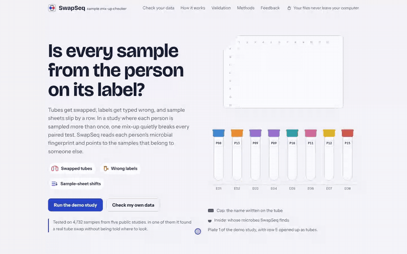

# SwapSeq

[](https://doi.org/10.5281/zenodo.23963612) [](https://bio.tools/swapseq) [](https://scicrunch.org/resolver/RRID:SCR_029248)

<p align="center"><a href="https://bymankirat.github.io/swapseq/"></a></p>

**A sample mix-up checker for longitudinal microbiome studies.** SwapSeq finds swapped tubes,
wrong labels and sample-sheet shifts from each person's microbial fingerprint. It runs entirely
in your browser: files you open are never sent anywhere.

**Use it:** open `index.html`, or the [hosted page](https://bymankirat.github.io/swapseq/). Full method and
every benchmark result: [Methods & validation](https://bymankirat.github.io/swapseq/validation.html).

Load a feature table (QIIME 2 `.qza`, BIOM 1 or 2,
or a text table) and the sample metadata, choose the column that says who each sample came from,
and press *Check samples*. Try the built-in demo first.

**SwapSeq Atlas:** how checkable are 42 public longitudinal microbiome datasets (20,974 samples, 29 studies)?
Checkability is highest for adult stool and vaginal swabs and very low for infant stool and lab mice. See the [Atlas](https://bymankirat.github.io/swapseq/atlas/).

**In R:** the [swapseqr](https://github.com/bymankirat/swapseqr) package runs the same engine on a
phyloseq object or a count matrix.

```r
remotes::install_github("bymankirat/swapseqr")
res <- swapseqr::check_swaps(ps, subject = "subject_id")
```

**On the command line and in pipelines** (Node.js 18 or newer, nothing else to install):

```bash
npx github:bymankirat/swapseq feature-table.tsv metadata.tsv --subject subject_id
```

It writes `swapseq.tsv` (one row per sample) and `swapseq.json` (summary, measured power and a Methods
sentence). Add `--fail-on-flags` to stop a pipeline when a sample is strongly flagged. Ready-made
[Nextflow](pipelines/nextflow/main.nf) and [Snakemake](pipelines/snakemake/Snakefile) steps are in
`pipelines/`. Run `npx github:bymankirat/swapseq --help` for every option.

**Shotgun data (new: web page, R and command line):**

- Strain markers (command line `--type markers`, R `type = "markers"`) compare samples on strain markers, genes or SNVs, for example
  MetaPhlAn marker presence, instead of species. On public cohorts this matched the species table in adults and helped only a
  little in infants ([results](validation/strain_markers/)).
- Host DNA, beta (command line `--host host_counts.tsv`, R `host =`) adds an independent check from the host's own DNA in the reads,
  which works where microbes change too fast to identify anyone (newborns, antibiotics). Tested in simulation
  so far; see [docs/host-dna.md](docs/host-dna.md) for how to make the input and the privacy rules for human
  genetic data.

**All data (new):**

- Duplicate check: two samples labelled as different people whose microbes are near-identical (one tube, extract or
  file under two names) are listed as possible duplicates. Works with one sample per person too.
- Several errors at once: swap pairs that point at each other are strong flags in tables where test swaps stand out
  well, and the tool says when a table holds more swap pairs than the expected error rate explains.
  See [validation/ye2026_comparison](validation/ye2026_comparison) for tests on the shotgun tables of Ye et al. (2026).
- Small studies: a clear swap in a table of 24 to 40 samples is now a strong flag (60–70% caught on subsamples of
  real tables, up from 1–30%), with no more flags on clean labels.
- Sturdier input: semicolon and old-Mac files, R tables without a corner cell, relative abundances, and clear
  messages for duplicate sample IDs, text in a count cell, empty or Excel files. `node cli/test_inputs.mjs` runs 60
  odd and broken files. See [validation/robustness](validation/robustness).

## What it reports

- **Strong flags** – samples that very likely belong to someone else, with the likely swap partner.
- **Check list** – weaker look-alikes to compare with lab records.
- **Evidence** – rare ASVs a flagged sample shares with the person it looks like, household
  look-alikes, plate positions of swap pairs, and possible sample-sheet shifts.
- **Possible duplicates** – two samples labelled as different people with near-identical microbes.
- **Power on your data** – measured, not guessed: SwapSeq hides test swaps and relabels in copies
  of your labels, reruns the check and reports how many it caught (v1.1).
- A QC audit table and a ready-made sentence for your Methods section.
- A report for your records (web page: *Download report*; command line: `PREFIX.html`). It is one HTML file with no scripts;
  open it in a browser and print it to PDF. It lists the flags, the reasons, the measured power and the limits, with space to
  note what the lab records showed.

## Method (v3)

1. Fingerprints: soft Jaccard on expected presence at a matched sequencing depth, and Aitchison
   distance (CLR).
2. Single-sample score: nearest own-person sample against nearest other-person sample.
3. Swap score: the gain in fit if two samples' labels were exchanged.
4. Self-calibration: errors are planted in a copy of the user's own table; scores become
   probabilities at two levels (flag and check).
5. Sample-sheet shift scan along plate wells or plating order.

Code: `method/core.mjs` (the same code runs in the page, in R and on the command line).

## Validation

Tested on 10 public tables from 5 studies (4,732 samples), with errors planted at about a 1% rate,
30–60 repeats each. Full numbers are in `validation/` and on the page.

| Data | Swapped samples flagged | Same pipeline with Bray-Curtis | False flags per 1,000 |
| --- | --- | --- | --- |
| 16S, adults (Student Microbiome Project gut, forehead, palm, tongue; Immigration Microbiome Project) | 43–92% | 2–38% | ≤ 0.4 |
| 16S, before/after (2 samples per person) | 40–53% | 0–3% | 0 |
| Shotgun, daily (Minnesota diet study) | 88–94% | 84–92% | ≤ 0.4 |
| Infants and same-donor mice (negative controls) | 0–3%, reported as low power | 0% | ≤ 0.3 |

In the Minnesota diet study (Johnson et al. 2019), SwapSeq found a real tube swap the authors had
corrected (MCT.f.0086 and MCT.f.0417) without being told where to look.

Limits: one confirmed real error so far; adult 16S results come from two studies; plate patterns
were tested on one real plating order. A flag is a reason to check lab records, not proof.

### Studies used

- Flores GE et al. 2014, *Genome Biology* – Student Microbiome Project
- Vangay P et al. 2018, *Cell* – Immigration Microbiome Project
- Bokulich NA et al. 2016, *Science Translational Medicine* – ECAM
- Johnson AJ et al. 2019, *Cell Host & Microbe* – Minnesota diet study
- Gibson TE et al. 2025, *Nature Microbiology* – MDSINE2 mice

## Rerun the benchmark

Node.js 22, no other software. Clone the source repositories listed in `method/load.mjs` into one
folder, point `SWAPSEQ_DATA` at it, then run for example
`SWAPSEQ_DATA=~/swapseq-data SETS=gut,tongue node method/bench.mjs 30 0.01`.

## Changes

- **v1.1.1, third November update** – A report for your records (web page and command line): flags, four figures, plain-language notes, limits. Clearer plots on the web page. Flags and probabilities unchanged. Tested and reported, not added: strain markers in infants ([results](validation/strain_markers/)) and a check for mixtures of two people ([results](validation/mixtures/)).
- **v1.1.1, second November update** – A clear swap in a small table (24–40 samples) is now a strong flag. Sturdier file reading with clear error messages. Results on 34 public tables are in [validation/robustness](validation/robustness/).
- **v1.1.1, November update** – Command-line tool (`npx github:bymankirat/swapseq`) with Nextflow and Snakemake examples. Strain-marker mode for shotgun tables. Host-DNA check: each sample's host reads at common SNPs are scored against every person's pooled reads; a stress test on simulated people (uneven DNA, relatives, twins, contamination) gave almost no false flags and caught 85-100% of swaps with 2,000-4,000 covered sites and 6 samples per person, but few with 2-3 samples per person; identical twins are reported as "identical DNA" (not yet tested on real data). The web page gets a data-type choice and a host-DNA input (beta). Duplicate check (planted duplicates in 15 public shotgun tables: 97% found in cross-sectional and 63% in longitudinal tables, no unplanted pair). Reciprocal swap pairs on the check list become strong flags in tables that separate swaps well: with 3% of samples swapped in 7 shotgun tables, strong flags caught 41% of swaps instead of 5%, other samples flagged 2.8 instead of 0.1 per 1,000; on the 29 published tables tested, strong flags went from 76 to 78. A note suggests a higher expected error rate when a table holds many swap pairs (at 3%: about 80% caught). Tested and not adopted: letting the data raise the error rate automatically (more false flags on published labels); time-aware fingerprints for infants and antibiotics (strong flags on hard tables 2.6% → 4.2%, but 13 times more false check-list entries).
- **v1.1.1** – Measured power no longer reads low when a table already holds errors: near-certain flags (P ≥ 0.9) are set aside before the hidden tests. Average gap to an independent measurement on tables with 1–2% errors: 9 points (1.1.0: 11; 1.0: 7); on clean tables unchanged at 9 (1.0: 31).
- **v1.1.0** – Power is now measured on your own table: SwapSeq hides one swap or relabel at a time in copies of your labels, reruns the check and reports how many it caught. In 1.0 the power figure could read near 0% on clean tables that SwapSeq checks well; across 30 public tables (the SwapSeq Atlas) the average gap to an independent measurement fell from 31 to 9 points. Flags and probabilities are unchanged (method v3).
- **v1.0.1** – Public Methods & validation page, feedback and problem-report forms, citation details. Method unchanged (method v3).
- **v1.0.0** – First release.

## Privacy and use

SwapSeq has no server, sets no cookies and uses no analytics. Fonts are served from this site,
not from Google. It is a research quality-control tool, not a medical device, and must not be
used for diagnosis or clinical decisions.

## How to cite

Singh M. (2026). *SwapSeq: a sample mix-up checker for longitudinal microbiome studies* (v1.1.1). Zenodo. https://doi.org/10.5281/zenodo.23963612

Registered in bio.tools as [biotools:swapseq](https://bio.tools/swapseq) and in the SciCrunch Registry as [RRID:SCR_029248](https://scicrunch.org/resolver/RRID:SCR_029248). In papers, please cite it as *SwapSeq (RRID:SCR_029248)* together with the DOI.

Author: Mankirat Singh, ORCID [0009-0005-3375-2123](https://orcid.org/0009-0005-3375-2123)

## Licence

Copyright (C) 2026 Mankirat Singh. SwapSeq is free software under the GNU General Public License,
version 3 or later (`LICENSE`). You may use, study, share and change it; versions you share must
stay under the same licence and keep this copyright notice. Third-party parts keep their own
licences (`THIRD_PARTY_NOTICES.md`). If you use SwapSeq in published work, please cite it
(`CITATION.cff`).

Made by [Mankirat Singh](https://bymankirat.github.io/myportfolio/).
